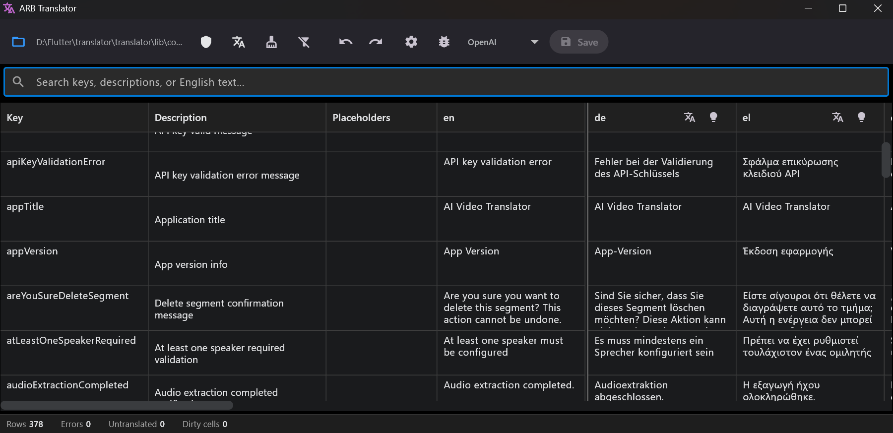

<div align="center">
<h1>ARB Translator</h1>
</div>
<p><strong>Fast Windows\Linux desktop tool for managing and AI‑assisting Flutter <code>.arb</code> translations.</strong></p>




---

## Why Use It?
Tired of juggling multiple `.arb` files, guessing what is untranslated, or fixing runtime placeholder errors? ARB Translator puts every locale key in one clean grid, validates placeholders instantly, tracks edits precisely, and can auto‑translate safely with AI.

## What You Get
Focused benefits:

* One merged view of all locales
* Guaranteed metadata consistency (only in base `en` file)
* Instant placeholder mismatch warnings
* Clear progress: counters for Errors / Untranslated / Dirty
* Safe bulk & per‑cell AI translation (placeholders preserved)
* Undo / Redo for edits, renames, deletions
* Deterministic save (sorted keys, stable diffs)
* Orphan / empty English key cleanup
* Fast on large projects (5k+ rows)

## Core Features
* Inline multi‑line editing
* Bulk translate column: All or Only Empty
* Per‑cell translate button
* Live search (by key)
* Filters: Errors, Cells to translate (empty or source changed)
* Dirty & error highlighting per cell & locale header
* Undo / Redo stack cleared after successful save
* Keyboard shortcuts: Ctrl+S / Z / Y, F2 (edit hook)
* Cancellable batch translation with progress
* Secure (not logged) API key usage + glossary prompt support

## AI Translation
* Preserves `{placeholders}` strictly
* Optional glossary bias
* Retry (up to 3 attempts) on transient errors
* Bulk mode skips already filled cells when you pick “Only Empty”

## Command Line
The same translation runs headless, e.g. in CI. From the `arb_translator` folder:

```sh
export OPENAI_API_KEY=sk-...
dart run arb_translator:arb_translator_cli --dir ../lib/l10n --locales de,fr
```

By default it translates every non-template locale in the folder, filling empty cells and cells whose English text changed since they were translated (the same rule as **"Only Empty"** in the app).

| Option | Meaning |
| --- | --- |
| `-d, --dir` | Folder with the ARB files (template and locales). Required. |
| `-l, --locales` | Comma-separated target locales. A locale without a file gets one. Default: every locale found. |
| `--mode` | `missing` (default): empty and stale translations. `all`: every key, overwriting existing translations. |
| `-k, --keys` | Comma-separated keys to limit the run to. |
| `--remove-orphans` | Delete keys that locale files have but the template does not. |
| `--provider` | `openai` (default) or `mock` (offline, for trying the tool out). |
| `--model` | Model name sent to the provider. Default: `gpt-6.1-sol`, the app's default. The model set in the app is not read; pass it here. |
| `--endpoint` | Chat-completions URL of an OpenAI-compatible server. Default: OpenAI. |
| `--api-key` | API key. Default: the `OPENAI_API_KEY` environment variable. |
| `--glossary-file` | Text file with glossary / style instructions added to every prompt. |
| `--batch-size` | Keys per request. Default: 100. |
| `--dry-run` | Report what would change; call no provider, write no file. |

What it guarantees:
* The English template is never written.
* Only locale files the run changed are written, and only the keys it changed; key order and the rest of the file stay as they were.
* A translation that loses or renames a placeholder, or breaks a plural/select, is rejected and the cell is left unchanged.
* Locale files must be named `<prefix><locale>.arb` with a matching `@@locale`; otherwise the run stops before writing anything.

Exit codes: `0` — done; `1` — finished, but some cells failed (listed on stderr); `64` — bad command line or folder.

## Placeholder Safety
Every edit or AI result re‑checks placeholder sets vs English. Any difference = highlighted error + filterable.

## Source Change Tracking
* Automatically detects when source (English) text has changed using SHA-256 hashing
* Every ARB file (including translated locales) stores `"sourceHash"` in the `@key` annotation — the SHA-256 of the English string **that locale's translation was made from**, so staleness is tracked per locale (retranslating one language doesn't clear the others) and can be detected without the English file
* Shows ⚠️ icon next to keys with modified source text
* Displays count of changed source keys in stats panel
* Bulk translate **"Only Empty"** automatically re-translates keys with a changed source too — no need to re-translate by hand after editing English strings
* **"Cells to translate" filter** — shows all cells that need attention: empty translations and translations whose source text has changed (detected via SHA-256), so you always know exactly what to work on next
* "Commit Source Hashes" button to mark all hashes as confirmed after reviewing changes
* Helps identify which translations need updating after source text modifications

## Cleanup Tools
* Remove orphan keys (not in base file)
* Remove empty-English keys

## Roadmap (Short)
* Expanded editor dialog
* Add/remove locale stubs
* Dirty-only filter
* Multi‑provider AI strategy selector
* Diff / report export

## License
GPLv3 – see [LICENSE](./LICENSE).

## Disclaimer
AI output may require human review. Do not send sensitive data to external APIs.

---
Enjoy faster, safer localization. 🚀

